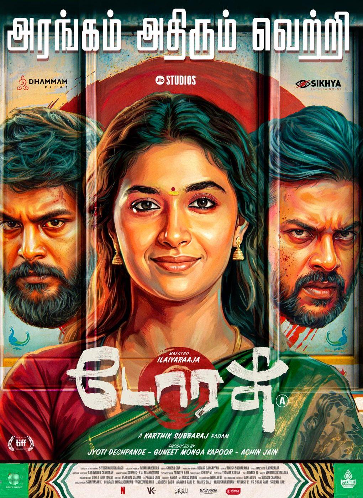
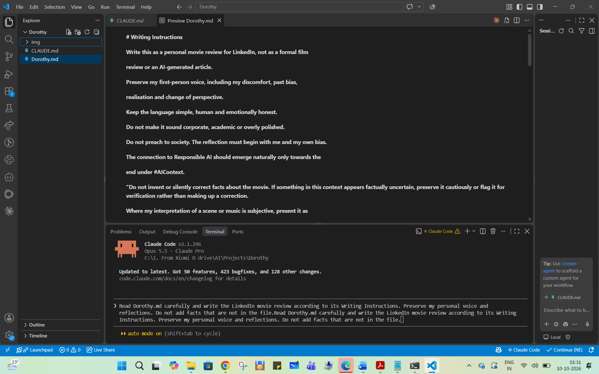
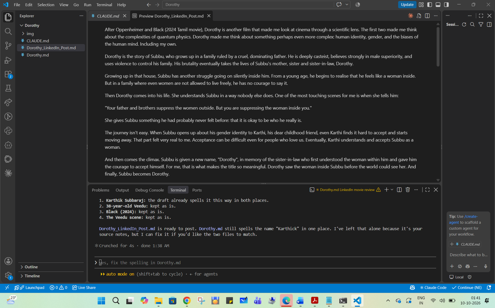

# Dorothy: A Personal Review, Composed with Context Engineering

  

My personal reflection on the Tamil film *Dorothy* (directed by Karthik Subbaraj, music by Maestro Ilaiyaraaja), written for LinkedIn.

I didn't ask AI to review the film for me. I wrote my own observations, discomfort, change of perspective and connection to Responsible AI into a Markdown context file, along with writing instructions. Then I asked an AI coding assistant ([Claude Code](https://claude.com/claude-code)) to compose them into an article. It was a small experiment in context engineering, for an article about how human bias shapes AI.

## Files

| File | What it is |
| --- | --- |
| [`Dorothy.md`](Dorothy.md) | The context file: my writing instructions at the top, then my raw notes under headings (`#Introduction`, `#Story`, `#Music`, `#Major Themes`, `#Realization`, `#Change`, `#Climax`, `#AIContext`) |
| [`Dorothy_LinkedIn_Post.md`](Dorothy_LinkedIn_Post.md) | The finished article |
| [`CLAUDE.md`](CLAUDE.md) | A project guide generated by Claude Code's `/init` that sums up my writing rules for future sessions |
| [`img/posters/`](img/posters) | Posters of *Dorothy*, and of *Black* and *Oppenheimer*, which the article opens with |
| [`img/screenshots/`](img/screenshots) | Screenshots of the writing session |
| [`img/ascii/`](img/ascii) | A side experiment: the *Dorothy* poster as ASCII art |

## How I made it

1. **Wrote the context file.** In VS Code, I created `Dorothy.md` with my writing instructions and my notes, in my own words. The instructions included: keep my first-person voice, don't preach, bring in the AI connection only at the end, don't invent or quietly correct facts about the film, present my readings of scenes and music as my own interpretation, and keep three key lines word for word.
2. **Set up the project.** I opened Claude Code in the VS Code terminal and ran `/init`, which created `CLAUDE.md`.
3. **Gave one prompt:**
   > Read Dorothy.md carefully and write the LinkedIn movie review according to its Writing Instructions. Preserve my personal voice and reflections. Do not add facts that are not in the file.

   
4. **Got the draft.** It reordered my notes into one story and smoothed the language. It flagged details it wasn't sure about (the director's spelling, the year of *Black*, the "38-year-old" *Veedu* reference) instead of correcting them on its own.

   
5. **Reviewed and published.** The post was about 5,400 characters, over LinkedIn's 3,000-character limit for a normal post, so I published it as a LinkedIn Article with the *Dorothy* poster as the cover.

The observations, discomfort and change of perspective are mine. The AI only arranged them.

## Copyright

© 2026 Johnbosco Vijayanand. All rights reserved. The film posters belong to their respective studios and are included only for reference alongside the review.
